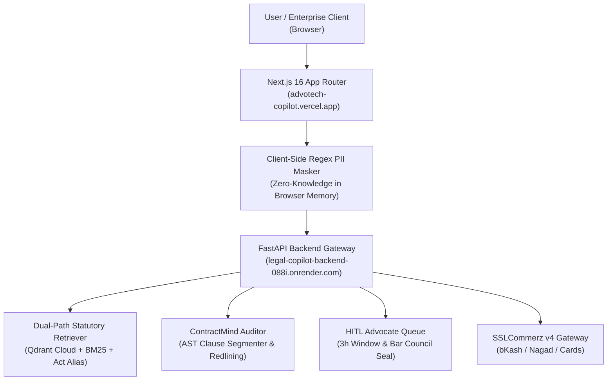

# Advotech Copilot (JusticeSphere AI)

[](https://nextjs.org/)
[](https://react.dev/)
[](https://www.typescriptlang.org/)
[](https://tailwindcss.com/)
[](https://github.com/mahmudulhasantasin/legal-copilot-backend)
[](#)

> **AI-Native Legal Intelligence, Autonomous Contract Auditing & Verified Advocate Marketplace for Bangladesh Law.**  
> Built for the **International AI Builders Congress 2026** under **Domain 10: JusticeSphere AI — Legal, Compliance & Trust Technologies**.

---

## 🌐 Live Deployments & Official Links

- **Live Production Application**: [https://advotech-copilot.vercel.app](https://advotech-copilot.vercel.app)
- **Interactive Whitepaper & Live Docs**: [https://advotech-copilot.vercel.app/docs](https://advotech-copilot.vercel.app/docs)
- **Backend API Repository**: [mahmudulhasantasin/legal-copilot-backend](https://github.com/mahmudulhasantasin/legal-copilot-backend)
- **Production Backend Endpoint**: [https://legal-copilot-backend-088i.onrender.com](https://legal-copilot-backend-088i.onrender.com)
- **FastMCP 2.0 Server**: [https://bd-legal-mcp-server.onrender.com/mcp](https://bd-legal-mcp-server.onrender.com/mcp)
- **Submission Dossier**: [SUBMISSION_DOSSIER.md](./SUBMISSION_DOSSIER.md)

---

## 📖 Complete Project Documentation

For comprehensive context covering:
- System Architecture & Monorepo Structure
- RBAC & Role Routing Matrix (5 Roles: General, Lawyer, Enterprise Admin, Enterprise Member, System Admin)
- Core Workflows (Legal Copilot, ContractMind, HITL Advocate Queue, Enterprise Playbooks, Admin Portal)
- Sovereign AI, Client-Side PII Masking & Dispatcher Algorithm
- Bangladesh Statutory Database (Contract Act 1872, Labour Act 2006, etc.)
- All 30+ Backend API Endpoints

👉 **Please read [PROJECT_CONTEXT.md](./PROJECT_CONTEXT.md)**

---

## 🏗️ Architecture Overview



---

## 🚀 Quick Start

### 1. Configure Environment
```bash
cd frontend
cp .env.example .env.local
```
Ensure `NEXT_PUBLIC_API_URL` points to your backend (`http://localhost:7860` for local or `https://legal-copilot-backend-088i.onrender.com` for live).

### 2. Install Dependencies
```bash
npm install
```

### 3. Run Development Server
From the repository root:
```bash
npm run dev
```
Or directly inside `frontend/`:
```bash
npm run dev
```

Open [http://localhost:3000](http://localhost:3000) with your browser.

### 4. Build for Production
```bash
npm run build
```

---

## 👥 Team & Repository Info
- **Team**: Outliers
- **Owner / Base Repository**: [mahmudulhasantasin/Outliers](https://github.com/mahmudulhasantasin/Outliers) (Branch: `main`)
- **Backend Service Repository**: [mahmudulhasantasin/legal-copilot-backend](https://github.com/mahmudulhasantasin/legal-copilot-backend) (Branch: `main`)
